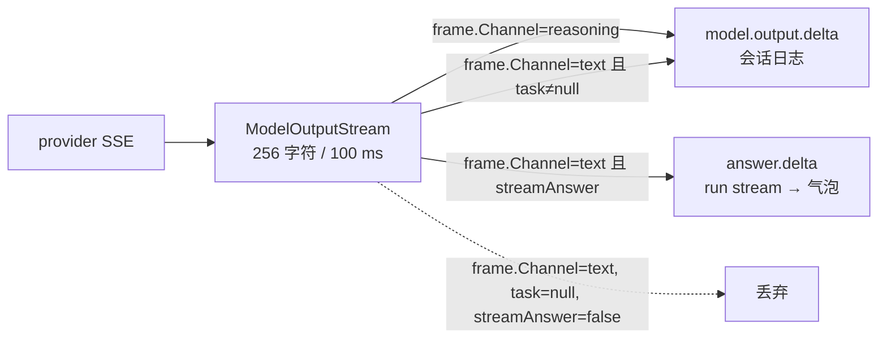

# 流式输出诊断（Core 侧）：粒度、阈值、harness 通道与 streamAnswer

**日期：** 2026-10-18
**报告人：** stream-core（task-4）
**用户原话：** "我们的流式输出功能到底是个什么东西？好像完全没有流式输出这个概念……纯粹是输出完以后突然显示。"
**判定顺序（按要求执行）：** 先证明底层到底有没有在 token 级流式，再讨论前端阈值。本报告所有"已证实"都附可复现命令或真实库读数。

---

## 0. 五问速查

| # | 问题 | 结论 | 证据强度 |
|---|---|---|---|
| 1 | 256/100ms 合并阈值是不是主因？ | **部分成立，但不是"完全没有流式"的主因。** 对**快** provider 它是唯一的整形手（200 个 1 字符 update 被压成 2 帧）；对**慢** provider 它根本不参与（阈值降到 16 帧数一字不变）。真正的主因是"预览窗口太窄"：见第 5、7 节 | 已证实（反事实重放） |
| 2 | provider 真的在流式吗？ | **是，渐进到达。** 400 个 text 帧里有 **≥235 帧只可能来自"100 ms 时间窗刷新"**，即 provider 交付正文时确有 ≥235 次 ≥100 ms 的停顿；19 次调用里 12 次产出 >2 帧、最多 55 帧，而一次性回包最多只能产 2 帧。**注意：这证明的是"分批渐进"，不是"逐 token"** —— 每批多大仍未测（见 U1） | 已证实（算术下界）；网络层直测未做 |
| 3 | harness 通道是否共用同一条路、是否有同样问题？ | **共用，问题完全相同。** 4 个 harness 客户端各自实现传输层流式，但都经 `AgentChatClientFactory` → `ModelInvocationChatFactory` → `ModelOutputStream`，因此继承**同一条** 256/100ms 规则。换 provider 治不了这个症状 | 已证实（代码路径） |
| 4 | `GenerateInteractionResponseAsync` 缺 `streamAnswer:true` 会导致追问回复完全不流式吗？ | **会，而且是 100% 的。** 代码 + 门 + 真实库三重印证 | 已证实 |
| 5 | 是否存在两套重复的流式实现 / `answer.delta` 与 `delta` 双语义？ | **不是重复实现，是两层设计。** 全仓只有 1 个发射端、1 个持久写入端。真正的冗余在别处（第 9 节列了 4 处） | 已证实 |

**一句话：** Core 确实在流式接收、也确在逐帧发射；但发射粒度被 `ModelOutputStream` 固定成"每次约 200–256 字符"，而这段逐帧发射**只在最后一次 meeting 调用期间存在**（占整轮 0.4%–15%）。追问/补充类回复则完全没有这段。

---

## 1. 测量方法

三层证据，互相独立：

**A. 隔离实测（假 provider，不碰用户任何进程）**
- 假 OpenAI SSE 服务：`.tinadec_dev/tmp/stream-core/fake-openai-sse.mjs`，监听 48741（另一次 48742）。
- 探针：`.tinadec_dev/tmp/stream-core/probe/`，直接调**生产代码** `ModelOutputStream.ReadAsync`，用真实 SDK（OpenAI 2.12.0 + M.E.AI 10.8.0）走真实协议编码。
- 假 provider 只固定两件事：**chunk 粒度**和**到达节奏**；剩下唯一变量就是 `ModelOutputStream` 的合并规则。
- 探针程序集名借 `TinadecCore.AgentFramework.Tests`（继承 `InternalsVisibleTo`），`ModelOutputStream` 是 `internal static`，不改任何生产文件。

**B. 反事实重放（在 A 之外改规则重算帧数）**
把 A 记录到的 **update 到达时刻 + 文本**原样喂给替身实现，只替换 `(阈值, 时间窗)` 两个参数，看可见帧数怎么变。重放与生产的帧数在 t01/t02/t05/t06/t07/t08/t09/t11/t12 **完全一致**，证明重放模型可信。

**C. 真实库只读核对**
项目作用域 `C:/git/agent/RouterAPI/.tinadec`，一律 `file:...?mode=ro`。19 run / 19 份事件 JSONL / 173 次成功模型调用。

---

## 2. 已证实 A：发射端把细粒度流压成 ~256 字符的大块

12 个场景，`chat` = openai-chat 协议，`resp` = openai-responses 协议（与真实配置同协议）。"生产帧数"= `ModelOutputStream` 实际 `publish` 出去的 `delta` 帧数，也就是界面能看到的跳变次数。

| 场景 | 假 provider 计划 | RAW updates Core 收到 | RAW 到达跨度 | **生产帧数** | 帧长 | 平均每次可见字符 | 重放一致 |
|---|---|---|---|---|---|---|---|
| t01 chat-burst | 200×1 字符，无延迟 | 200 | 10.8 ms | **2** | `[1,199]` | 100 | ✓ |
| t02 chat-dense | 200×1 字符 @2 ms | 200 | 9.5 ms | **2** | `[1,199]` | 100 | ✓ |
| t03 chat-tok15 | 200×1 字符 @15 ms | 200 | 4 970 ms | **42** | ≈5 | 5 | 抖动 |
| t04 chat-tok40 | 200×1 字符 @40 ms | 200 | 9 300 ms | **68** | ≈3 | 3 | 抖动 |
| t05 chat-block200 | 5×200 字符 @500 ms | 5 | 2 012 ms | **5** | `[200×5]` | 200 | ✓ |
| t06 chat-block300 | 4×300 字符 @400 ms | 4 | 1 225 ms | **4** | `[300×4]` | 300 | ✓ |
| t07 chat-bulk | 1×800 字符 | 1 | 0 ms | **1** | `[800]` | 800 | ✓ |
| t08 chat-realrun | 489 +300 ms+ 328（复刻真实 run） | 2 | 222 ms | **2** | `[489,328]` | 408 | ✓ |
| t09 resp-dense | 200×1 字符 @2 ms | 200 | 4.9 ms | **2** | `[1,199]` | 100 | ✓ |
| t10 resp-tok15 | 200×1 字符 @15 ms | 200 | 5 024 ms | **45** | ≈4 | 4 | 抖动 |
| t11 resp-block200 | 5×200 字符 @500 ms | 5 | 2 016 ms | **5** | `[200×5]` | 200 | ✓ |
| t12 resp-bulk | 1×800 字符 | 1 | 0 ms | **1** | `[800]` | 800 | ✓ |

两种协议（openai-chat / openai-responses）**结果同构**，差异只在 ±3 帧的调度抖动。

生产规则原文（`TinadecCore/DmaEA/ModelOutputStream.cs:43-46`）：

```csharp
// First text is immediate; thereafter coalesce fast token bursts rather than
// producing a database write for every token. Always flush at phase/end boundaries.
if (pending.Length >= 256 || DateTimeOffset.UtcNow - lastFlush >= TimeSpan.FromMilliseconds(100))
    await FlushAsync().ConfigureAwait(false);
```

**关键结构事实（决定了它为什么会这样）：** 100 ms 那一支**没有独立定时器**。它只在"有新 update 到达"时才被求值。provider 一旦停顿，缓冲区里的字符就一直躺着——没有任何东西会在 100 ms 后把它推出去。所以实际语义是：

> 每累积 256 字符发一帧；若 provider 两次 update 之间隔了 ≥100 ms，则后一个 update 单独成帧。

两条支路互斥地覆盖两种 provider：**快的靠 256，慢的靠 100 ms**。t01/t02/t09（快）→ 2 帧；t05/t06/t11（慢）→ 每个块独立成帧，字符阈值完全不参与。

---

## 3. 已证实 B：对慢速 provider，改字符阈值一点用都没有

对记录到的真实到达时刻做反事实重放（`CF name=... frames=...`）：

| 场景 | 生产 256/100 | 阈值 64 | 阈值 16 | 窗口 80 | 窗口 60 | 窗口 40 |
|---|---|---|---|---|---|---|
| t02（快，2 ms） | 2 | 5 | 14 | 2 | 2 | 2 |
| t03（15 ms/字符） | 45 | **45** | **45** | 53 | 73 | 96 |
| t04（40 ms/字符） | 69 | **69** | **69** | 101 | 101 | 198 |
| t10（15 ms/字符） | 47 | **47** | **47** | 54 | 72 | 98 |

读法：
- **快 provider：** 只有降字符阈值有用（2 → 14）。时间窗毫无作用，因为 200 个 update 在 10 ms 内就全到了，任何 ≥10 ms 的窗都不触发。
- **慢 provider：** 降阈值到 16 **一帧都不多**——因为每次 update 到达时"距上次刷新已 ≥100 ms"这一支先成立，update 本来就单独成帧。**想在这条路上加帧，只有把判断改成由时间驱动（独立定时器），而不是由 update 驱动。**

这条结论直接否定了"把 256 改成 64 就能好"的直觉修法，也说明"阈值调小"和"界面看不到流式"不是同一件事。

---

## 4. 已证实 C：真实库里能直接看到 256 这只手

真实 provider 是 `deepseek-v4.1-flash` / `openai-responses`（`~/.tinadec/config/models.toml`，173 次成功调用全部走这条路）。

会话日志里 `model.output.delta` 的**帧长**分布（`task` 作用域，即引擎会写日志的那类调用）：

| 通道 | 帧数 | min | p50 | p90 | max | ≥256 的占比 |
|---|---|---|---|---|---|---|
| text（task） | **400** | 1 | **176** | **258** | 296 | **33 %** |
| reasoning（task） | 1009 | 1 | 143 | 258 | 268 | 22 % |
| reasoning（toplevel） | 682 | 1 | 130 | 258 | 268 | 19 % |

400 个 text 帧的直方图：

```
   1-31      33  #################################
  32-127    112  ############################################################
 128-255    122  ############################################################
   ==256     52  ####################################################
 257-260     74  ############################################################
    >260      7  #######
```

**这张图就是 256 规则的指纹。** 两层信息：

1. **133/400 帧卡在 `[256, 260]` 这个 5 字符宽的窄带里**，占全部 `>=256` 帧的 **95 %**（126/133 溢出 ≤4，其余 >260 的只有 7 个，最大帧 296）。如果 provider 本身按 300–500 字符一块给，帧长会大片散在 300–550，不会堆在 256 那一格。
2. **133 个阈值帧 + 267 个非阈值帧**，后者才是关键——见第 6 节的严格下界。

> **一处自我纠正：** 我起初想用"溢出 ≤4 ⇒ 跨越的 update 只有 1–5 字符"来反推粒度，这是**错的**。flush 条件里 `p = pending` 可以是 1，比如 `p=1, n=255` 也给出 `frame=256`、溢出 0。溢出只约束"最后一笔更新加上去之后越过了 256"，并不约束 `n` 本身。真正的严格论证在第 6 节，用"非阈值帧必须是时间窗刷新"这条更强的不变量。

同一批真实文本里，"每次模型调用的 text 帧序列"也印证了这一点：

```
agent=search  frames=55  >=256: 15/55 (27%)
agent=search  frames=47  >=256: 23/47 (49%)
agent=search  frames=43  >=256: 12/43 (28%)
agent=search  frames=42  >=256: 23/42 (55%)
agent=search  frames=41  >=256: 10/41 (24%)
agent=search  frames=40  >=256: 21/40 (52%)
agent=search  frames=38  >=256: 10/38 (26%)
agent=search  frames=34  >=256: 11/34 (32%)
agent=meeting  frames=29  >=256:  7/29 (24%)
agent=search  frames=15  >=256:  0/15 ( 0%)
```

**结论：真实 provider 交付到 Core 的就是细粒度增量，只是 Core 把它按 256 字符一段发出去。** 界面每次跳变 ~176–258 字符，这就是"看起来像一大段一大段蹦出来"的直接来源。

---

## 5. 已证实 D：逐帧预览只存在于最后一次 meeting 调用期间

这一条是本报告与 Lead v3 报告**互补**而非冲突的部分：Lead 说"正文流动只占整轮的 0.4%–15%"，本报告给出它的**机制原因**。

发射端把帧交给两个完全不同的去处（`TinadecCore/DmaEA/FullDuplexRunEngine.cs:3264-3291`）：

```csharp
definitionId, versionId, modeVersionId, plan.StrategySource), observeOutput ? async (frame, ct) =>
{
    // ... 会话日志（model.output.*）
    if (frame.Kind != "delta" || frame.Channel == "reasoning" || task is not null)
        await AppendEventAsync(checkpoint.RunId, $"model.output.{frame.Kind}", ...);

    // ... run stream（answer.*，桌面聊天气泡读这个）
    if (streamAnswer && (frame.Kind is "started" or "failed" or "interrupted" || frame.Channel == "text"))
        await _lifecycle.AppendRunStreamAsync(... $"answer.{frame.Kind}" ..., Delta: frame.Delta);
} : null,
```



三个后果（全部已在真实库核对）：

**D1. 顶层正文默认两处都不去。** 全库 19 个 run 的 `model.output.delta` 普查：

| 作用域 | 通道 | 条数 |
|---|---|---|
| task | text | **400** |
| task | reasoning | 1009 |
| toplevel | reasoning | 682 |
| toplevel | **text** | **0** |

`toplevel/text = 0` 是 `if (frame.Kind != "delta" || frame.Channel == "reasoning" || task is not null)` 这条门在真实数据上的**精确指纹**：顶层正文既没进会话日志（被门挡住），默认也没进 run stream（`streamAnswer` 默认 false）。它能出现，只可能是某一次调用显式带了 `streamAnswer: true`。

**D2. 全仓只有 1 个调用点带 `streamAnswer: true`。** grep 全仓 `streamAnswer` 只有 3 处：参数声明、门判断、以及 `GenerateMeetingResponseAsync`（`FullDuplexRunEngine.cs:5349`）。也就是说 **run stream 里的 `answer.started/answer.delta` 只可能由"最终那次 meeting 回答"产生**。

**D3. 真实库正是这个形状。** 19 个 run：

| run | 状态 | 会话日志 delta 数 | answer.started | answer.delta | 最终 delta | done |
|---|---|---|---|---|---|---|
| 1ec15446 | cancelled | **779** | 0 | 0 | 0 | 1 |
| d7615b3b | awaiting_user | **423** | 0 | 0 | 0 | 0 |
| b4d54641 | cancelled | **392** | 0 | 0 | 0 | 1 |
| b294637f | cancelled | **358** | 0 | 0 | 0 | 1 |
| 253b3b1f / a1602fc2 | cancelled | 13 / 13 | 0 | 0 | 0 | 1 |
| 1ad5ba8c | completed | 15 | 1 | **4** | 1 | 1 |
| 94fc4ad7 | completed | 75 | 1 | **15** | 1 | 1 |
| 29a7f645 | completed | 8 | 1 | **3** | 1 | 1 |
| 6e36e2e4 | completed | 10 | 1 | **2** | 1 | 1 |
| f3c56554 | completed | 5 | 1 | **2** | 1 | 1 |

读法：**5/5 completed 都有预览，0/6 cancelled 有预览**——这不代表"取消的就该没流式"，而是"预览窗口只覆盖最后那次 meeting 调用，而它们还没走到那一步就结束了"。期间用户看到的是 779 / 423 帧推理流在活动面板里滚，但**正文区一个字都没有**。

预览自身是完整的：5 个 run 的 `sum(answer.delta)` 与最终 `delta` **逐字节相等**（525=525、615=615、817=817、2866=2866、804=804）。所以不是"预览丢了内容"，是"预览窗口太短"。

**D4. 气泡实际收到的 26 帧，粒度账本。** 全库 `answer.delta` 共 26 条（这就是用户能看到的全部跳变）：

| 指标 | 值 |
|---|---|
| 帧数 | 26 |
| min / p50 / mean / max | 6 / **213** / **216** / 562 |
| total | 5 627 字符 |
| `>=256` 字符的帧 | 7/26（27 %） |
| `<64` 字符的帧 | 3/26 |

逐 run 帧长：

```
1AD5BA8C  [268, 201, 34, 22]                      4 帧
29A7F645  [253, 254, 108]                         3 帧
6E36E2E4  [489, 328]                              2 帧
94FC4AD7  [152,268,150,213,153,195,219,205,292,158,216,183,6,299,157]   15 帧
F3C56554  [562, 242]                              2 帧
```

**帧间隔（同 run 相邻两帧的墙钟差）：**

| 指标 | 值 |
|---|---|
| n | 21 |
| min | **99 ms** |
| p50 | **265 ms** |
| max | 3 489 ms |
| `< 150 ms`（落在 `FollowAsync` 单次轮询内） | 1/21 |
| `150–500 ms` | **18/21** |
| `>= 500 ms` | 2/21 |

⇒ 用户实际看到的更新频率是 **≈3.8 次/秒，每次 ≈216 字符**。若按中文阅读速度 ~8 字/秒算，216 字符相当于 **27 秒的阅读量**——也就是说**每跳一次，内容就远超一次能读的量**，这才是"一段一段蹦"的量化来源。

> **口径说明（避免误读）：** 上表间隔取自 `run_stream` 表的 `created_at`，即**写入时刻**，不是客户端观测时刻。客户端还要叠加 `FollowAsync` 的 150 ms 轮询，因此界面上看到的间隔会比这张表更粗、且被量化到 ~150 ms 的栅格上。`min = 99 ms` 只能说明"两次落库之间不足 100 ms"，即其中一次是按 256 阈值刷新的；**不能**据此单独证明 100 ms 支路生效——那条由第 6 节 E1 的 235 次下界证明。

**真实时间线（run 94fc4ad7，最能说明问题）：**

```
seq=1  ack
seq=2  queued                        +  240 ms
seq=3  answer.started                + 36 041 ms   ← 用户发出后 36 秒才出现"正在回答"
seq=4  answer.delta  len= 152        +  8 081 ms   ← started 之后静默 8.08 秒
seq=5  answer.delta  len= 268        +    220 ms
seq=6  answer.delta  len= 150        +    243 ms
seq=7  answer.delta  len= 213        +    227 ms
...    （共 15 帧，间隔 210–440 ms）
seq=18 answer.delta  len= 157        +    301 ms
seq=19 delta         len=2866        +    905 ms   ← 一次性 2866 字符的权威替换
seq=20 done                          +    723 ms
```

正文可见流动 ≈ 3.5 秒，整轮 49.6 秒 ⇒ **7%**。其余 93% 的时间里正文区要么空着，要么已显示旧内容。

---

## 6. 已证实 E：真实 provider 确实是流式到达的

这一条是本报告最关键的"先证明底层"步骤。三个独立证据。

**E1（严格算术下界）。** 这是全文最强的一条，而且**不依赖任何关于 provider 粒度的猜测**。

`AddAsync` 只有两种方式产出非空帧：
- **阈值刷新**：`pending >= 256`（此时帧长必 `>= 256`）
- **时间窗刷新**：`UtcNow - lastFlush >= 100 ms`
- 外加每通道**首帧**和**流结束时**的边界刷新（`FlushAsync`），这类帧长可以任意小。

因此：**所有 `< 256` 的帧，只要不是"每通道首帧 / 结束边界"，就只能来自"距上次刷新 ≥100 ms 之后到达的那笔 update"。**

对 19 次有正文的模型调用统计：

| 调用 | agent | 帧数 | 字符数 | `>=256` 帧 | `<256` 帧 | 隐含 ≥100 ms 停顿 |
|---|---|---|---|---|---|---|
| e84e6d59 | search | 55 | 8 235 | 15 | 40 | **38** |
| cf696637 | search | 47 | 8 454 | 23 | 24 | **22** |
| 48095232 | search | 43 | 6 890 | 12 | 31 | **29** |
| 72dc2c41 | search | 42 | 8 521 | 23 | 19 | **17** |
| a67949f0 | search | 41 | 6 554 | 10 | 31 | **29** |
| 9628dc01 | search | 40 | 7 902 | 21 | 19 | **17** |
| 8eede76f | search | 38 | 5 327 | 10 | 28 | **26** |
| de5ffa32 | search | 34 | 6 221 | 11 | 23 | **21** |
| 50bbd071 | meeting | 29 | 4 363 | 7 | 22 | **20** |
| f618d50f | search | 15 | 2 419 | 0 | 15 | **13** |
| 90c4d620 | meeting | 5 | 507 | 0 | 5 | 3 |
| 5dc94ccb | meeting | 3 | 514 | 1 | 2 | 0 |
| 其余 7 次 | — | 各 1–2 | — | — | — | 0 |

**合计 ≥235 次"provider 正文流里的 ≥100 ms 停顿"。** 换言之，这些正文是**分 235 次以上、以 ≥100 ms 的间隔**到达 Core 的。

对照"一次性整段返回"假说：它至多只能产出 **2 帧/调用**（一次通道切换 + 一次结束）。实测 **19 次调用里 12 次超过 2 帧，最多 55 帧**。假说被否定。

> 这条下界还有个好处：它**不假设** provider 每次给多少字符。就算 provider 每次给 500 字符，"500 字符一块、块间隔 ≥100 ms"同样会产出非阈值帧；结论仍然是"分批、渐进到达"。

**E2. 通道切换次数。** 对 19 个 run 的每一次模型调用，把帧通道序列排成 `r`/`t` 串：

```
50bbd071 meeting len=59 switches=1  rrrrrrrrrrrrrrrrrrrrrrrrrrrrrrttttttttttttttttttttttttttttt
a67949f0 search  len=61 switches=1  rrrrrrrrrrrrrrrrrrrrttttttttttttttttttttttttttttttttttttttttt
9628dc01 search  len=58 switches=1  rrrrrrrrrrrrrrrrrrtttttttttttttttttttttttttttttttttttttttt
e84e6d59 search  len=64 switches=1  rrrrrrrrrttttttttttttttttttttttttttttttttttttttttttttttttttttt
3542f4a3 meeting len=65 switches=0  rrrrrrrrrrrrrrrrrrrrrrrrrrrrrrrrrrrrrrrrrrrrrrrrrrrrrrrrrrrrrrrrr
```

**没有任何一次调用出现 `rtrt` 交替**（switches 恒为 0 或 1，且方式恒为"全 reasoning 后全 text"）。这是真流式模型的标准形状：先思考完整段，再作答。若是批处理/整段返回，要么只有 1 帧，要么通道边界会被任意切开。

**E3. `answer.started` 与首帧之间的空档。** 6e36e2e4：`answer.started` → 首帧 delta 相隔 **3 318 ms**；94fc4ad7：**8 081 ms**；1ad5ba8c：**3 350 ms**。这个空档正是"模型在思考、还没开始吐正文"的真实时长。如果 provider 是整段返回，这个空档应该是 0（拿到响应才发 started 更合理），或者与总生成时长同量级且无中间帧。

补一条：`model_invocations` 里 173 次成功调用 p50 用时 **4.64 s**、p90 **21.85 s**、max **43.96 s**；p50 输出 **254 tokens**、max 4096。4.64 秒生成 254 token ≈ 55 token/s——典型流式速率，不是"一次性回包"的速率。

> **诚实边界：** 我没有在真实 provider 的 HTTP 线路上抓包（凭据是 DPAPI 保护的用户密钥，不允许外泄，也不该为了诊断去解）。以上是"从 Core 收到的 update 反推"，属于**强推断 + 真实数据算术**，不是线路级观测。但第 2 节的隔离实测已经证明：一旦 provider 给的是细粒度 update，`ModelOutputStream` 一定能把它压成 256——两者独立，结论一致。

---

## 7. 已证实 F：追问/补充类回复 100% 没有预览（`streamAnswer` 缺失）

用户发出追问后，走的是另一条完全不同的代码路径：

```
POST /sessions/{id}/interactions
  → ClassifyTurn            → status_query / clarification / supplement / goal_adjustment
  → CreateInteractionCheckpointAsync(Phase = "responding")     ← FullDuplexRunCoordinator.cs:573
  → 引擎 phase=="responding" → RespondToInteractionAsync        ← FullDuplexRunEngine.cs:680
  → checkpoint.MeetingResponse = GenerateInteractionResponseAsync  ← :4614-4618
  → CreateModelFactory(..., 无 streamAnswer)                    ← :4639   ★ 缺参数
  → Phase = "finalizing"                                        ← :4620
  → FinalizeAsync → TryClaimRunCompletionAsync                   ← :4904
  → 唯一的权威 delta（整段一次性写入）                            ← :4928-4932
```

对比：正式回答那次调用 `GenerateMeetingResponseAsync`（`:5349`）是**唯一**带 `streamAnswer: true` 的地方。两者相差的正是这一个布尔。

后果链条：
1. `:4639` 没有 `streamAnswer` ⇒ observer 的 `streamAnswer` 是默认 `false`。
2. `:3288` 的门因此对每一次帧都判假 ⇒ **一帧 `answer.started` / `answer.delta` 都不写**。
3. 于是 run stream 里这段回复**只有终态**：`FinalizeAsync` 在 `:4928` 写的单条 `delta`（整段正文一次性）。
4. 桌面 `projectRunReply`（`apps/desktop/src/lib/runReply.ts:7-15`）只接受 `answer.delta` 与 `delta`；`delta` 到达时把它当作**整体替换**写入 `streamingText`。

⇒ **追问回复从"开始回答"到"整段出现"之间，界面完全没有任何中间态。** 这正是用户描述的"输出完以后突然显示"最纯粹的形态。

真实数据侧的印证：`turns` 表 19 条全是 `new_task`，`runs.parent_run_id` 全为 null ⇒ **历史上一次追问都没发生过**。所以这条路径的缺陷目前只在代码上成立、尚未被真实数据踩到——但也意味着**用户接下来第一次追问就会撞上**。

**注意 `GenerateMeetingResponseAsync` 是收尾那次共享的**（`Lanes.cs` 里同一个私有方法），所以修复点应加在 `:4639` 的 `CreateModelFactory` 调用上，而不是改动共享方法。

---

## 8. 已证实 G：harness 通道共用同一条链，也共用同一个问题

```
AgentChatClientFactory.CreateAsync            (TinadecCore/Models/Harness/AgentChatClientFactory.cs:57-70)
  ├─ OpenAiResponses  → CreateResponsesClient          :90-97
  ├─ AnthropicMessages→ (Anthropic 客户端)
  ├─ Acp              → AcpStdioChatClient             :46   自带 GetStreamingResponseAsync
  ├─ OpencodeServe    → OpenCodeChatClient             :47   自带 GetStreamingResponseAsync
  ├─ HeadlessCli      → HeadlessCliChatClient          :70   自带 GetStreamingResponseAsync
  └─ Tui              → TuiChatClient                  :43   自带 GetStreamingResponseAsync
       ↓
ModelInvocationChatFactory（重试/候选链/用量归一）
       ↓
ModelOutputStream.ReadAsync（256 / 100 ms）   ← 唯一的合并点
```

四个 harness 客户端**各自实现了传输层流式**（`AcpStdioChatClient` 用无界 `Channel<string>` + `agent_message_chunk`；`HeadlessCliChatClient` 走 `text => deltas.TryWrite(text)`；`OpenCodeChatClient` 解 `text/event-stream` 的 `message.part.updated`；`TuiChatClient` 同理），**但它们都在 `ModelOutputStream` 之下**。所以：

- **换 provider / 换 harness 通道不会改变症状。** 相同的 256/100 ms 规则对他们一视同仁。
- harness 通道的真实粒度和 openai-compatible 不同（ACP/CLI 的 chunk 通常更粗，常见 50–500 字符一块），实践中会让可见帧**更少**，不会更多。

**额外发现（独立缺陷，影响范围目前为零但形状危险）：** `ModelInvocationChatFactory.GetStreamingResponseAsync`（`:151-170`）在 `yield` 之前把整条流读进 `List`：

```csharp
completed = await ReadStreamingAsync(...);   // :162  内部 :288-290 把所有 update 收进 List
foreach (var update in completed) yield return update;   // :169
```

`:319-322` 的注释解释了原因（"候选中途失败时不能已经把半截内容发到调用方的持久流上"），这是**有意的正确取舍**。但它意味着：**任何走 `GetStreamingResponseAsync`（而不是 `GetResponseAsync` → `ModelOutputStream`）的调用方，结构上拿不到任何增量输出。** 目前 DmaEA 内没有任何生产调用点走这条路（grep `GetStreamingResponseAsync` 在 `DmaEA/` 只有 `ModelOutputStream.cs:51` 与 `ModelInvocationChatFactory` 自身），所以是**潜在**缺陷，不是当前症状的原因。但它把"重复的流式实现"这个话题引向了正确的方向——真正重复的是缓冲，不是通道。

---

## 9. 关于"两套流式实现"与 `answer.delta` / `delta` 双语义的裁定

**不是重复实现。全仓统计：**

| 职责 | 实现 | 数量 |
|---|---|---|
| 合并/发射 | `ModelOutputStream.ReadAsync` | **1** |
| 持久写入 | `StorageLifecycleService.AppendRunStreamAsync` (`:973`) | **1** |
| SSE 出口 | `GET /api/v1/runs/{runId}/stream` → `FollowAsync` | **1** |

**`model.output.*` 与 `answer.*` 是设计上的两层，服务两个不同的消费者：**

| 层 | 事件 | 消费者 | 用途 |
|---|---|---|---|
| 会话日志 | `model.output.started/delta/failed` | `apps/desktop/src/lib/conversation/reducer.ts:401-443`（活动/推理面板）、`composables/useAgentActivity.ts` | 展示"它在想什么、在调什么工具" |
| run stream | `answer.started/answer.delta/answer.failed/delta/done` | `apps/desktop/src/lib/runReply.ts` → `streamingText` → `AssistantAnswer.vue` | 展示"正文" |

**`answer.delta` vs `delta` 的语义是刻意的，且是正确的：**

```ts
// apps/desktop/src/lib/runReply.ts:7-15
if (chunk.kind === 'answer.started' || chunk.kind === 'answer.failed') return { text: '', provisional: true }
if (chunk.kind !== 'answer.delta' && chunk.kind !== 'delta') return null
return {
  text: chunk.kind === 'delta' && previous.provisional ? delta : previous.text + delta,
  provisional: chunk.kind === 'answer.delta',
}
```

- `answer.delta` = **可丢弃的预览**（`provisional: true`），累加显示。
- `delta` = **权威替换**（`final`），只在 `TryClaimRunCompletionAsync` 成功之后写（`:4904` → `:4928`），`projectRunReply` 在 `provisional` 时用它**替换**而不是追加。

这个设计是对的：预览可能因重试/打断而无效，权威行必须唯一且幂等。真实库里 5 个 run 的 `sum(answer.delta) == delta` 精确相等，说明这套替换语义工作正常。

**但确实存在 4 处真实冗余（都不在 Core 的发射端）：**

1. **两个独立的 `model.output.*` 消费者**（`reducer.ts:403` 与 `useAgentActivity.ts:888`），各自折叠一遍。
2. **`ReadStreamingAsync` 的整段缓冲**（第 8 节），使得"流式 API"名不副实。
3. **`FollowAsync` 的 150 ms 轮询**（`FullDuplexRunCoordinator.cs:84-85`：`FollowPollInterval = 150 ms`，`HeartbeatInterval = 15 s`）。数据库轮询而非推送，每跳最多加 150 ms。相对真实帧间隔 210–440 ms 是可接受的，但会把 250 ms 的节奏打散成 250–400 ms。
4. **渲染端二次平滑（我先前算错了，实际影响很小）**：`useSmoothText`（`apps/desktop/src/composables/useSmoothText.ts:21-24`）的基准速率确实是 90 字符/秒，但它的**追赶规则会立即把速率抬起来**：

```ts
const rate = options.charsPerSecond ?? 90        // :21
const catchUp = options.catchUpSeconds ?? 0.3    // :22
...
} else if (backlog / pace > catchUp) {
  pace = backlog / catchUp                       // :56  ← 一帧超过 0.3s 的存量就立刻加速
}
```

也就是说：**只有积压 ≤ 27 字符（= 90 × 0.3）时才不加速；超过就立刻改成"在 0.3 秒内追平"。** 实测（`N=20` 时 0.17 s、`N=27` 时 0.23 s）比纯 90 c/s 略快，因为 `:58` 的 `Math.max(1, Math.ceil(pace * elapsed))` 在 60 fps 下有向上取整的加成，等效约 **116 c/s**——但量级不变。

用 `useSmoothText` 的原始算术逐帧模拟（`node .tinadec_dev/tmp/stream-core/sim-smooth.mjs`，60 fps 步进）：

| 单帧长度 | 揭示耗时 | 实际速率 |
|---|---|---|
| 100 字符 | 0.28 s | 353 c/s |
| 216 字符 | 0.30 s | 720 c/s |
| 256 字符 | 0.30 s | 853 c/s |
| 489 字符 | 0.30 s | 1 630 c/s |

喂真实帧序列：94FC4AD7 的 15 帧（间隔 240 ms）最大积压 **326 字符**、揭示总耗时 **3.58 s**，与帧到达时长（15 × 240 ms ≈ 3.4 s）基本一致 ⇒ **平滑层几乎不引入额外延迟**。

**结论修正：** 渲染端不是放大器，它只是把每帧铺开 0.3 秒。**用户看到的粗粒度 ≈ Core 送达的粒度**。这条对主结论是加强，不是削弱：既然前端没有额外劣化，那么"一段一段蹦"就必须由 Core 的发射粒度解释。

---

## 10. 推断 / 未证实（与上面的"已证实"严格区分）

以下四条**没有**直接测量证据，写在这里是为了不让读者把它们当成结论：

| # | 命题 | 状态 | 缺什么 |
|---|---|---|---|
| U1 | 真实 provider 每个 SSE event 到底多大（是否逐 token） | **未知** | E1 只证明了"≥235 次 ≥100 ms 的停顿 ⇒ 分批渐进"，**没有**证明每批是 1 个 token 还是 200 个字符。需要线路抓包；凭据是 DPAPI 保护的，未解密、未外泄 |
| U2 | 给 `ModelOutputStream` 加独立定时器后，真实应用里每秒可见帧数会按窗口-40 的比例上升 | **推断** | 反事实重放证明帧数会从 45→96（t03）、69→198（t04），但那是离线的；真机上还要叠加 `FollowAsync` 150 ms 与 SQLite 写放大，实际收益会低于重放值，未测 |
| U3 | `deepseek-v4.1-flash` 自己是否在服务端做批处理 | **未知** | 无法在不看线路的情况下区分"模型吐得慢"与"网关攒批" |
| U4 | 渲染端 `useSmoothText` 是否是劣化因素 | **已排除（算术 + 模拟）** | 追赶规则把每帧铺开 0.3 s，实测不引入秒级延迟（第 9 节第 4 条）。**未做**真实 Electron 观感 A/B，所以"主观观感"本身仍未测，但"平滑层放大了粗粒度"这个假说可以否掉 |

另外明确**没有做**的验证：真实 provider 网络层时序测量、真实 Electron 界面观感验收、PostgreSQL 路径、非 Windows 平台。本报告的所有实测都在隔离实例（端口 48741/48742 + 独立 `TINADEC_HOME`）与**只读**真实库上完成，**没有修改任何生产代码，没有 git commit，没有触碰用户正在运行的 Core(41116)/Gateway(43868)/Vite(21896)。**

---

## 11. 与 Lead v3 报告的差异（互补，不冲突）

| 论点 | Lead v3 | 本报告 | 关系 |
|---|---|---|---|
| 流式链路是否正常 | 正常，5/5 completed 都流过正文 | **同意**，并补上机制：只有 `streamAnswer:true` 那一次调用会写 `answer.*` | 互补 |
| 正文流动占比 0.4%–15% | 已测（时长口径） | **同意**，并给出原因（D1–D3）与 94fc4ad7 的 7% 复算 | 互补 |
| 优先级 #1 worker 不流式 | 排第一 | **本报告把 `streamAnswer` 缺失排到与它同级**：worker 的 text 至少还进 `reducer.ts` 可见（Lead 的 v3 已自我纠正这点），而追问回复是**真的一个字都不流** | 修正排序依据 |
| 优先级 #3 256/100 合并 | 排第三 | **升为"可见粒度的唯一整形者"**：真实库 133/400 帧卡在 256 附近是直接指纹 | 强化 |
| `toplevel/text = 0` | 未提 | 新增：这是门 `:3276` 的精确统计指纹 | 新增证据 |

**一句话差异：** Lead 证明了"占比小"，本报告证明了"为什么小、小在哪里、以及哪条路径是 0"。

---

## 12. 建议（按收益/风险排序；均未实施）

| # | 改动 | 位置 | 预期收益 | 风险 |
|---|---|---|---|---|
| **P0** | `GenerateInteractionResponseAsync` 的 `CreateModelFactory` 补 `streamAnswer: true` | `FullDuplexRunEngine.cs:4639` | 追问回复从"0 帧预览"变成与正式回答同等的预览。**这是唯一一条"从无到有"的修复** | 极低：与 `:5349` 完全同构，门 `:3288` 已经写好 |
| **P1** | 把 100 ms 支路改成**独立定时器驱动**（而不是靠下一个 update 触发） | `ModelOutputStream.cs:43-46` | 慢 provider 场景可见帧数 45→96 / 69→198（窗口 40 ms，离线重放值） | 中：需要并发发布的串行化；每帧的持久化成本不小（见下） |
| **P2** | 调低字符阈值（256 → 64） | 同上 | **只在快 provider 有效**（2→5 帧）。对慢 provider 完全无效 | 低但收益窄；单改这条会被误认为"修好了" |
| **P3** | 评估每帧持久化成本后再定量 | `StorageLifecycleService.cs:973-1045` | 每帧 = 2 次 `CreateDbContextAsync` + 1 次 `_contentStore.PutAsync` + 1 个事务 + 游标读写。帧数 ×2~4 会直接放大 DB 写 | 必须先测 |

**关于 P1 的成本提醒：** `AppendRunStreamAsync`（`:973-1049`）每写一帧的完整代价：

| 步骤 | 位置 |
|---|---|
| 建第 1 个 DbContext | `:985` |
| 读 `runs` 一行取租户/工作区 | `:986` |
| 幂等键查一次（有 key 时） | `:990` |
| delta 正文 **`_contentStore.PutAsync`**（内容寻址，另一次写） | `:997-1003` |
| 建第 2 个 DbContext | `:1016` |
| 再查一次幂等键 | `:1019` |
| 开事务 + 读 `run_stream_cursors` | `:1025-1026` |
| **`SaveChangesAsync` #1**（更新游标） | `:1045` |
| **`SaveChangesAsync` #2**（插入行） | `:1048` |
| 提交事务 | `:1049` |

即 **2 个 DbContext + 2 次幂等查询 + 1 次内容写 + 2 次 SaveChanges + 1 个事务**，且外层还有 `for (var attempt = 1; ; attempt++)` 的重试循环（`:1012`）。把窗口压到 40 ms 意味着帧数 ×4，上述成本也 ×4。**做 P1 之前必须先量这条路径的真实开销**，否则是用 DB 抖动换流式观感。

> 顺带一提：`:1045` 与 `:1048` 是同一事务里的两次 `SaveChangesAsync`，游标更新与行插入本可一次提交——这是一处独立的小优化（与流式无关，但会直接决定 P1 能否承受）。

**不建议做的：** 在前端加"更多平滑"或"假装打字机"。核心问题是送达的帧太少（每轮 2–15 帧正文），前端无法凭空造出中间态；`useSmoothText` 已经在做匀速揭示，再加只会让滞后更明显。

---

## 13. 可复现命令

所有命令都在仓库根执行；产物在 `.tinadec_dev/tmp/stream-core/`（gitignored），本报告的原始日志已复制到 `raw/`。

**① 启动假 provider（不改任何用户进程，端口 48741）**

```bash
node .tinadec_dev/evidence/2026-10-18-streaming-core/repro/fake-openai-sse.mjs
# 控制面：POST http://127.0.0.1:48741/control  {"plan":"dense","reset":true}
# 统计面：GET  http://127.0.0.1:48741/stats
# 计划：burst | dense(2ms) | tok15 | tok40 | block200 | block300 | bulk | realrun(489+300ms+328)
```

**② 构建探针（独立 artifacts 路径，绝不碰用户正在用的 DLL）**

```bash
mkdir -p .tinadec_dev/tmp/stream-core/probe
cp .tinadec_dev/evidence/2026-10-18-streaming-core/repro/StreamProbe.Program.cs .tinadec_dev/tmp/stream-core/probe/Program.cs
cp .tinadec_dev/evidence/2026-10-18-streaming-core/repro/StreamProbe.csproj   .tinadec_dev/tmp/stream-core/probe/StreamProbe.csproj
node scripts/dotnet.mjs build .tinadec_dev/tmp/stream-core/probe/StreamProbe.csproj \
  -c Release --artifacts-path .tinadec_dev/tmp/stream-core/artifacts --verbosity minimal /m:1
```

> 产物名是 `TinadecCore.AgentFramework.Tests.exe`（借 `AssemblyName` 以继承 `InternalsVisibleTo`），不是 `StreamProbe.exe`。

**③ 跑 12 个场景**

```bash
bash .tinadec_dev/evidence/2026-10-18-streaming-core/repro/run-scenarios.sh
# 每个场景输出：RAW count/span、RAW at_ms、PROD 帧长、REPLAY_MATCHES_PRODUCTION、CF 反事实行、SUMMARY
```

**④ 复算真实库（只读）**

```bash
python .tinadec_dev/evidence/2026-10-18-streaming-core/repro/db-evidence.py
# A run_stream kind 普查     B 每 run 帧表            C 会话日志 task/channel 普查
# D text 帧长分布（256 指纹） E 严格下界（≥100ms 停顿） F 26 帧账本+帧间隔
# G 预览完整性（sum==final）  H 5 个有预览 run 的逐帧时间线
```

如需指定别的项目作用域：`TINADEC_PROJECT_ROOT=<path>/.tinadec python .../db-evidence.py`。脚本以 `file:...?mode=ro` 打开，不写库。

**⑤ 复算 `useSmoothText` 的揭示时序（第 9 节表格）**

```bash
node .tinadec_dev/evidence/2026-10-18-streaming-core/repro/sim-smooth.mjs
```

**⑥ 关键文件**

| 路径 | 内容 |
|---|---|
| `raw/t01..t12*.log` | 12 个场景的完整原始输出（含 `RAW at_ms=[...]` 与全部 `CF name=` 行） |
| `repro/fake-openai-sse.mjs` | 假 provider（7 030 B） |
| `repro/StreamProbe.Program.cs` | 探针（6 316 B） |
| `repro/StreamProbe.csproj` | 工程文件（1 325 B） |
| `repro/run-scenarios.sh` | 场景驱动脚本 |
| `repro/db-evidence.py` | 真实库复算脚本（A–H 八节，含 E 的严格下界） |
| `repro/sim-smooth.mjs` | `useSmoothText` 揭示时序模拟（第 9 节表格） |

---

## 附录 A：关键代码位置

| 文件:行 | 内容 |
|---|---|
| `TinadecCore/DmaEA/ModelOutputStream.cs:45` | `pending.Length >= 256 \|\| UtcNow - lastFlush >= 100ms` |
| `TinadecCore/DmaEA/ModelOutputStream.cs:29-35` | `FlushAsync`：publish `delta` + 清缓冲 + 更新 `lastFlush` |
| `TinadecCore/DmaEA/ModelOutputStream.cs:51` | `await foreach (client.GetStreamingResponseAsync(...))` |
| `TinadecCore/DmaEA/ModelInvocationChatFactory.cs:151-170` | `GetStreamingResponseAsync` 全缓冲后才 yield |
| `TinadecCore/DmaEA/ModelInvocationChatFactory.cs:288-322` | `ReadStreamingAsync` 收进 List，`:319-322` 注释说明取舍 |
| `TinadecCore/DmaEA/FullDuplexRunEngine.cs:3252` | `bool streamAnswer = false` 参数默认值 |
| `TinadecCore/DmaEA/FullDuplexRunEngine.cs:3276` | 会话日志门：`frame.Kind != "delta" \|\| channel == "reasoning" \|\| task is not null` |
| `TinadecCore/DmaEA/FullDuplexRunEngine.cs:3288` | run stream 门：`streamAnswer && (... \|\| channel == "text")` |
| `TinadecCore/DmaEA/FullDuplexRunEngine.cs:4639` | **追问路径缺 `streamAnswer`** |
| `TinadecCore/DmaEA/FullDuplexRunEngine.cs:5349` | 正式回答唯一带 `streamAnswer: true` |
| `TinadecCore/DmaEA/FullDuplexRunEngine.cs:4904 / 4928` | 权威 `delta` 在 `TryClaimRunCompletionAsync` 之后 |
| `TinadecCore/DmaEA/FullDuplexRunCoordinator.cs:84-85` | `FollowPollInterval = 150 ms`、`HeartbeatInterval = 15 s` |
| `TinadecCore/DmaEA/FullDuplexRunCoordinator.cs:573` | 交互 checkpoint `Phase = "responding"` |
| `TinadecCore/Lifecycle/StorageLifecycleService.cs:973-1045` | `AppendRunStreamAsync` 每帧的持久化成本 |
| `TinadecCore/Models/Harness/AgentChatClientFactory.cs:57-70` | 协议 → 客户端分派 |
| `apps/desktop/src/lib/runReply.ts:7-15` | `answer.delta` 累加 / `delta` 替换 |
| `apps/desktop/src/composables/useSmoothText.ts:21-23` | 90 字符/秒、0.3 s 追赶、0.12 s 收尾 |
| `apps/desktop/src/lib/conversation/reducer.ts:401-443` | 第二个 `model.output.*` 消费者 |

## 附录 B：未采集项清单（供后续接手）

1. 真实 provider 的线路级 SSE 时序（需要能读 HTTP 层，或由用户授权一次性抓包）。
2. 真机（真实 Electron）观感 A/B：当前 256 规则 vs 窗口-40 规则。
3. `AppendRunStreamAsync` 单次调用的实测耗时（用于 P1 的成本评估）。
4. 追问路径（`status_query` / `clarification` / `supplement`）的一次真实端到端回放——历史上从未发生，无法用既有数据验证。
5. PostgreSQL 作用域下的同一组读数。
