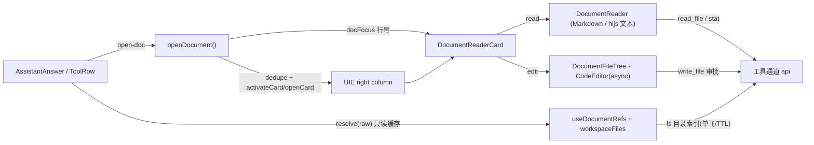

## 用户需求

Agent 在回答中会引用工作区文档。用户点击对话流里的文档引用后，右侧边栏渲染该文档；阅读态要能一键切到编辑器，编辑器里同时展示文件夹结构。

## Product Overview

对话流中的文档引用变成可点击内联标记，点击后在右侧边栏新开一个 `docReader` 页签，以极简模式渲染文档内容；在该页签内可切换到编辑器模式，左侧出现工作区文件夹树，右侧是 monaco 编辑器，保存沿用现有审批流。

## Core Features

**1. 引用识别（前端自动识别，不改 Core）**

- 回答 Markdown 里的行内代码与链接，若形如 `docs/spec.md`、`src/api.ts:120`、`docs/spec.md#L120`，且经工作区目录索引确认确有其文件，就渲染为可点击引用，并带上引用行号。
- 工具行「它改动的文件」列表同样可点击。
- 未确认、格式不符或属于外部 URL 的路径保持原样纯文本，不做假链接。

**2. 侧边栏阅读器**

- 新增右侧栏卡片 `docReader`，每篇文档一个页签，标题为文件名；同一路径重复点击只激活已有页签，不会开第二个。
- 右栏折叠时点击引用自动展开右栏。
- 渲染规则：Markdown 走现有 Markdown 渲染能力（代码块、表格、callout、mermaid）；其余文本/代码用等宽高亮只读展示；二进制或超大文件给出明确「不支持预览 / 文件过大」提示，不渲染空白。
- 阅读态顶栏显示文件名、相对路径、引用行号标记、刷新、在编辑器中打开。

**3. 侧边栏编辑器与文件夹结构**

- 点「在编辑器中打开」在同一页签内切到编辑态：左侧是可收起的文件夹树（懒加载、过滤 node_modules/.git/release 等重目录），右侧是 monaco 编辑器。
- 由引用进入时若带行号，编辑器定位到该行并高亮该行。
- 保存复用现有 `write_file` 审批流：需审批后落盘，携带载入时的 `file_hash`，被外部改动时拒绝覆盖而不是静默覆盖。
- 在编辑器里点文件树中的文件会打开（或激活）对应文档页签。

**4. 边界**

- 仅作用于当前项目工作区内的文件；越界路径（`..`、工作区外绝对路径）不生成引用。
- 引用校验失败不阻塞阅读，只在缺失时给出可重试的失败态。
- 不改动整页 `/code-editor`（该页后续将移除），不做 Core/Gateway 契约变更。

## 技术栈

沿用现有栈，不引入新依赖：

- 前端：Vue 3.6 + TypeScript + Vite + Tailwind（`apps/desktop`）
- 布局：TinadecUI 布局引擎（`apps/TinadecUI`）—— 卡片注册表 + `openCard` 命令 + provide/inject 卡片上下文
- 渲染：`marked` + DOMPurify + highlight.js（已有）；编辑器 monaco（已有，懒加载）
- 文件读写：无 REST 端点，走现有工具通道 `read_file` / `ls` / `stat`（`api.ts:3560-3567`）
- 写盘：`createUserToolActionForPath(cwd,'write_file',{filepath,content,file_hash})` 审批流

## 实现思路（关键决策与取舍）

**决策 1：右栏用新 descriptor，不新建布局系统。** 在 `apps/TinadecUI/src/components/cards/index.ts` 的 `buildUieRegistry()` 里追加 `docReader`（`singleton:false, movable:true, closable:true, detachable:true, minWidth:320, minHeight:220`）。组件放 `apps/desktop/src/components/document/`，由 `cards/index.ts` 以 `@/components/document/...` 引入——与 `SpatialWorkCard.vue` 完全同构，`apps/TinadecUI/tsconfig.json` 的 `paths` 已指向 `../desktop/src`。

不加入 `featureCatalog.ts`：功能网格与「+」菜单无法凭空指定文档，加入只会给出一个打不开的空页签；`featureCatalog.test.ts` 只校验 id 去重，不受影响。

**决策 2：一文档一页签 + 应用侧去重。** reducer 的 `openCard` 只对 `singleton` 复用实例（`engine/reducer.ts:349-355`），不会按 `state.path` 去重。因此在 desktop 侧写 `openDocument()`：先扫 `useUie().snapshot.value.cards` 找同 `projectId+path` 的 `docReader`，命中就 `activateCard`，未命中才 `openCard({ slotId:'right', title: basename, state:{ path, line } })`。标题用 `title` 落地，`useCardTitle()` 对「非内置标题」原样展示，因此页签直接显示文件名。

**决策 3：同一文档被再次引用的行号变化。** `activateCard` 无法改 `state`。用模块级 `docFocus` ref（`{ path, line, nonce }`）承载「最新一次引用位置」，卡片 watch 它更新自己的行号并滚动；比新增 reducer 命令成本低，也比复用 `openCard(instanceId)` 安全（后者会重复插入 tabId）。

**决策 4：引用校验用目录索引，不用逐文件 stat。** 每条回答里通常有 2–8 个路径，逐文件 `stat` 是 N 次工具调用；改为按「父目录」向 `ls` 取一次并缓存（单飞 + 30s TTL + LRU 200），一次回答通常只打 1–3 次。缓存同时服务文件夹树，避免两套目录读取。

**决策 5：校验必须异步且无副作用。** `MarkdownRender` 的 `blocks` 是 computed，不能在解析中发请求。契约是：`resolve(raw)` 只读缓存，命中且确为文件才返回引用，未命中返回 null 并把路径放入去重队列（单飞、并发 2、负结果 60s TTL）；队列回来后 bump `revision`，`MarkdownRender` 通过可选的 `docRefsVersion` prop 依赖它触发重解析，把纯文本升级为可点引用。缺省不传 resolver 时行为与现在完全一致（`SpatialWorkCard` 复用该组件，不会被波及）。

**决策 6：阅读态不加载 monaco。** monaco 入口约 3.9MB。阅读态用已注册的 highlight.js + `<pre>`；`CodeEditor` 用 `defineAsyncComponent(() => import(...))` 只在切到编辑态时才拉 chunk。为此把 `MarkdownRender.vue:100-119` 的 hljs 注册与 240 条高亮缓存抽到 `lib/highlight.ts` 共享，避免二次注册与两套缓存。

**决策 7：纯前端识别、零契约改动。** 不新增 Core 端点、不改 `openapi.core.json` 快照、不动 Gateway。代价是「Agent 想说但没写出路径」的引用无法识别；这是本轮明确接受的范围，`DocumentRef` 结构保留 `source` 字段，将来接结构化引用时只换数据源。

## 架构与数据流



## 性能与可靠性

- 引用校验：每条回答的候选路径去重后入队，同一路径 60s 内最多一次请求；解析本身是同步缓存查表，O(候选数)。
- 目录索引：单飞 + 30s TTL + LRU 200，键含 `cwd`；保存成功后按父目录精确失效，不整表清空。
- 流式：`revision` 只在校验落定时变化，重解析次数为「首帧 + 若干次落定」，不随 delta 线性增长。
- 阅读态：>512 KiB 不读全文，走「文件过大」态；`read_file` 本身按行返回，需在渲染前给出行数上限保护。
- 文件夹树：过滤 `node_modules/.git/dist/build/release/runtime`，只展开到的目录才 `ls`（仓库既有教训：`apps/desktop/release` 有 1112 个 html）。
- 安全：路径必须落在 `cwd` 内（拒绝 `..` 逃逸与工作区外绝对路径）；Markdown 仍走既有 DOMPurify 全量净化后才注入 `data-*`；写盘一律经审批 + `file_hash` 乐观锁。
- 降级：`useUie()` 未初始化、右栏不存在、项目未选时 `openDocument` 返回 false 并静默处理，不抛异常打断对话渲染。

## 目录结构

```
apps/TinadecUI/src/components/cards/index.ts        # [MODIFY] 注册 docReader descriptor（非 singleton，右栏可放），保持其余 17 个条目与顺序不变
apps/desktop/src/lib/highlight.ts                   # [NEW] 从 MarkdownRender 抽出 hljs 语言注册、highlightCode 与 240 条缓存，供对话与阅读器共用
apps/desktop/src/lib/documentPath.ts                # [NEW] 纯函数：parseDocumentRef（path/path:12/path#L12/行区间）、normalizeWorkspacePath（拒绝越界）、isMarkdownPath/isTextLikePath/documentBaseName
apps/desktop/src/lib/workspaceFiles.ts              # [NEW] 工作区目录索引：listWorkspaceDir（单飞+30s TTL+LRU 200）、findWorkspaceEntry（返回 file/dir/null）、invalidateWorkspaceDir
apps/desktop/src/composables/useDocumentRefs.ts     # [NEW] 引用解析器：只读缓存命中才返回 DocumentRef，未命中入去重队列（并发 2、负结果 60s），暴露 resolve + revision；随 cwd 变化重置
apps/desktop/src/lib/documentWorkspace.ts           # [NEW] openDocument()：路径归一化、同 path 去重激活、openCard(title=文件名, state)、右栏折叠时展开；导出 docFocus
apps/desktop/src/components/document/DocumentReaderCard.vue  # [NEW] docReader 卡片外壳：inject uie:cardState 取 path/line，解析项目 cwd，read/edit 切换，透传审批事件，保存后失效目录缓存
apps/desktop/src/components/document/DocumentReader.vue      # [NEW] 只读渲染：Markdown→MarkdownRender；文本→hljs pre（行号 + 定位到引用行）；不支持/过大→明确提示态；顶栏含文件名、相对路径、行号标记、刷新、在编辑器中打开
apps/desktop/src/components/document/DocumentFileTree.vue    # [NEW] 紧凑文件树：懒加载、受控展开、重目录过滤、选中当前文件高亮、收成 32px 图标栏，emit select
apps/desktop/src/components/MarkdownRender.vue      # [MODIFY] 新增可选 prop docRefs / docRefsVersion 与 open-doc emit；净化后把命中的行内 code 与内链标记为 data-doc-path；bodyRef 上扩展点击与键盘委托；改用 lib/highlight
apps/desktop/src/components/conversation/AssistantAnswer.vue # [MODIFY] 新增 workspaceRoot prop，useDocumentRefs 并传 resolver/version，收到 open-doc 调 openDocument
apps/desktop/src/components/conversation/ConversationTurn.vue # [MODIFY] 两处 AssistantAnswer 补传 workspace-root
apps/desktop/src/components/conversation/ToolRow.vue          # [MODIFY] changedPaths 由纯 li 改为可点击按钮（复用 conversation-link-button），调用 openDocument
apps/desktop/src/components/code/CodeEditor.vue    # [MODIFY] 新增可选 revealLine prop：载入后 revealLineInCenter + 整行装饰；缺省不改变现有行为
apps/desktop/src/styles.css                         # [MODIFY] 新增 .markdown-doc-ref 内联引用、阅读器/文件树/行号槽样式，全部走既有 CSS 变量与 data-theme
apps/desktop/src/locales/zh-CN.ts                   # [MODIFY] 新增 docReader.* 与 uie.cardTitle.docReader
apps/desktop/src/locales/en.ts                      # [MODIFY] 同上
apps/desktop/src/locales/zh-TW.ts                   # [MODIFY] 同上
apps/desktop/src/locales/ja.ts                      # [MODIFY] 同上
apps/desktop/src/locales/ru.ts                      # [MODIFY] 同上
apps/desktop/src/lib/documentPath.test.ts           # [NEW] 解析与越界拒绝用例
apps/desktop/src/lib/documentWorkspace.test.ts      # [NEW] 去重/激活/展开右栏用例（桩 registry）
apps/desktop/src/lib/workspaceFiles.test.ts         # [NEW] 单飞、TTL、失效、错误不伪装为空用例
apps/desktop/src/components/document/DocumentReader.test.ts   # [NEW] Markdown/文本/不支持/过大/行号定位
apps/desktop/src/components/document/DocumentFileTree.test.ts # [NEW] 懒加载、过滤、选中回调
apps/desktop/src/components/MarkdownRender.test.ts  # [MODIFY] 补 docRefs 升级与 open-doc 用例，保持既有 15 例不变
```

## 关键数据结构

```ts
// lib/documentPath.ts
export interface DocumentRef { path: string; line?: number }
export function parseDocumentRef(raw: string): DocumentRef | null
export function normalizeWorkspacePath(cwd: string, raw: string): string | null // 越界返回 null

// composables/useDocumentRefs.ts
export interface DocumentRefResolver {
  resolve(raw: string): DocumentRef | null // 仅缓存命中；未命中入队并返回 null
  revision: Ref<number>
}
export function useDocumentRefs(cwd: Ref<string | null>): DocumentRefResolver

// lib/documentWorkspace.ts
export const DOC_READER_CARD = 'docReader'
export const docFocus: Ref<{ path: string; line?: number; nonce: number } | null>
export function openDocument(input: { path: string; line?: number; projectId?: string | null }): boolean

// PersistedCardInstance.state（descriptorId === 'docReader'）
interface DocReaderState { path: string; line?: number; projectId?: string | null }
```

## 验证

1. `cd apps/desktop && npm run typecheck`（vue-tsc 零错误）
2. `npx vitest run src/lib/documentPath.test.ts src/lib/workspaceFiles.test.ts src/lib/documentWorkspace.test.ts src/components/MarkdownRender.test.ts src/components/document src/locales/i18nParity.test.ts`
3. `npm run build` 确认阅读态未把 monaco 拉进首屏 chunk，`CodeEditor` 仍是独立动态 chunk
4. Electron 实机：回答里带 `path:line` 的引用可点 → 右栏展开并渲染；同文档二次点击不新开页签；切编辑器出现文件树、定位到行、审批保存后目录树刷新

## 设计定位

不是新造一套界面，而是把「文档」做成右侧栏里与 Git / 审批 / 浏览器同级的原生卡片。材质、圆角、间距、动效全部继承现有 UIE 面板（`usePanelStyles` + `--surface-*` 变量），卡片本身透明，由外层 stack 提供毛玻璃/描边，避免出现第二个视觉系统。

## 阅读态

- 顶栏 36px：`FileText` 图标 + 文件名（13px/500）+ 相对路径（11px，`--text-muted`，超长省略并用 title 展示全文）+ 引用行号胶囊（`第 12 行`，`--accent-soft` 底、`--text-brand` 字）+ 右侧 24px ghost 按钮（刷新、在编辑器中打开）。
- 正文留白 20px，Markdown 复用现有 `.markdown-body` 排版，阅读宽度收敛到 72ch，长代码块与表格沿用现有横向滚动岛。
- 代码/文本使用等宽 `--font-mono`，12.5px / 1.65 行高，左侧 40px 行号槽（11px，`--text-muted`，`--bg-tertiary` 底）；被引用行整行 `--accent-soft` 高亮 + 左侧 2px `--accent-primary` 竖线，进入时居中滚动。
- 不支持与过大：虚线描边卡片（沿用 `--border-dashed` 空态范式），一句原因 + 一个「在编辑器中打开」主按钮，不做无内容的空白页。

## 编辑态

- 布局：左 `DocumentFileTree`（展开 176px / 收起 32px 图标栏）+ 右 `CodeEditor`（flex-1，最小宽度保护）。
- 树行高 24px，每级缩进 12px，11.5px 字号；hover `--surface-hover`，选中 `--bg-selected` 且左侧 2px `--accent-primary` 标记；文件夹 chevron 120ms 旋转，只展开时才请求目录。
- 切换阅读/编辑用同一顶栏位置，不做整页跳转；编辑器保留现有保存/撤销/格式化按钮与审批卡片，审批结果就地回显。

## 对话流中的引用

行内代码引用加 1px 虚线底边（`color-mix(--accent-primary 45%, transparent)`）+ `--text-brand` 前景，指针为 pointer，hover 时 `--surface-hover` 背景并显示 `打开 docs/spec.md 第 120 行` 的 title；聚焦时给 `--shadow-focus` 环。不带行号时省略「第 N 行」。点击后引用本身不改变颜色（避免「已读」虚假状态）。

## 动效与无障碍

- 所有 hover/展开 120ms `cubic-bezier(0.23,1,0.32,1)`，`prefers-reduced-motion` 下全部退化为即时。
- 引用标记是 `role="button" tabindex="0"`，Enter/Space 与点击同效；加载与错误用 `aria-live="polite"`；树节点用 `aria-expanded`。
- 深浅色均只为既有变量换值，不新增硬编码颜色（monaco 行装饰除外，按 `isDark` 取两套 rgba）。

## Agent Extensions

### SubAgent

- **code-explorer**
- Purpose: 在实现前复核 `cards/index.ts` 注册表断言、`i18nParity.test.ts` 的键校验方式，以及 `HomeGitPlacement.test.ts` 是否对右栏 tab 数量有硬断言，避免新增 descriptor 打挂既有测试。
- Expected outcome: 一份受影响的测试清单与需要同步调整的断言位置，保证实现阶段一次通过。